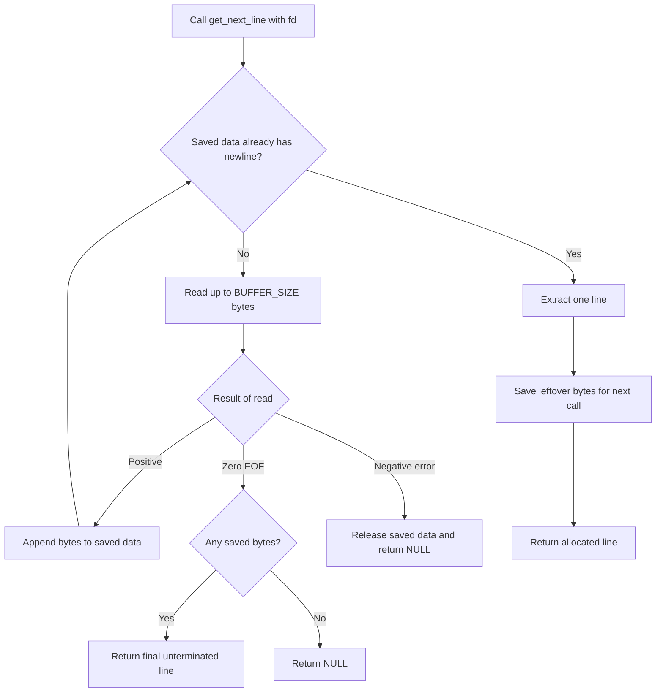

# Get Next Line — 1337 / 42 Learning Guide

> **Source of truth:** Official **Get Next Line**, version **14.3**, Chapters I–VII, supplied with this project. This README is a learning companion and an implementation plan, **not** a replacement for the official subject. Statements marked **[Official]** are grounded in that subject; statements marked **[Recommended]** are learning strategies or design suggestions, not additional grading rules.
>
> **Before submission:** Verify that in the first line is your exact 42 login, and update the **AI Use Disclosure** to accurately describe your actual workflow.

## Table of Contents

1. [Description](#description)
2. [Official Subject: Requirements and Boundaries](#official-subject-requirements-and-boundaries)
3. [Theoretical Foundations](#theoretical-foundations)
4. [Detailed Algorithm and Justification](#detailed-algorithm-and-justification)
5. [Project Structure and Responsibilities](#project-structure-and-responsibilities)
6. [Step-by-Step Implementation Roadmap](#step-by-step-implementation-roadmap)
7. [Instructions: Compilation and Execution](#instructions-compilation-and-execution)
8. [Testing and Debugging](#testing-and-debugging)
9. [Optional Bonus: Multiple File Descriptors](#optional-bonus-multiple-file-descriptors)
10. [Peer-Evaluation and Defense Preparation](#peer-evaluation-and-defense-preparation)
11. [Troubleshooting](#troubleshooting)
12. [Practice Exercises and Learning Schedule](#practice-exercises-and-learning-schedule)
13. [Resources](#resources)
14. [AI Use Disclosure and Academic Integrity](#ai-use-disclosure-and-academic-integrity)
15. [Final Self-Check and Subject Traceability](#final-self-check-and-subject-traceability)

---

## Description

**Get Next Line** is a C programming exercise in reading **one line at a time** from a **file descriptor**. Instead of loading an entire file into memory, the function must remember any bytes that were already read but do not belong to the line it is returning.

**Required public interface:**

```c
char *get_next_line(int fd);
```

The function is called repeatedly. Each successful call returns a dynamically allocated string containing the next line, **including its terminating `\n` if one exists**. When no further line is available, or a read error occurs, it returns `NULL`.

For example, a text file containing:

```text
Hello
1337
Last line
```

(Here the illustrated file has a newline after each line.)

produces this sequence of calls:

| Call | Return value | Meaning |
| --- | --- | --- |
| `get_next_line(fd)` #1 | `"Hello\n"` | First line |
| `get_next_line(fd)` #2 | `"1337\n"` | Second line |
| `get_next_line(fd)` #3 | `"Last line\n"` | Third line |
| `get_next_line(fd)` #4 | `NULL` | No more text |

If the file's **last** line lacks a newline, that last return must **not** invent one.

### Why the project matters

The important skill is not string splitting by itself. You will learn to coordinate **system calls**, **state that survives function calls**, **heap memory**, and **data boundaries** that do not match the boundaries of logical lines.

By the end, you should understand:

- Why `read()` returns **bytes**, not lines, and may return fewer bytes than requested.
- How a file descriptor relates to an open file or another readable stream.
- Why a function-local `static` variable can remember information between calls.
- How to separate a completed line from unread **leftover** bytes.
- How to allocate, transfer ownership of, and free strings safely.
- Why **EOF**, **read error**, and **newline found** are three different events.
- How input size, `BUFFER_SIZE`, and memory-copy strategies influence complexity.
- How to explain and test the behavior without relying on a copied solution.

### General workflow



The flowchart illustrates one **recommended design**, not a prescribed implementation from the subject.

---

## Official Subject: Requirements and Boundaries

### Mandatory contract — Chapter IV (printed pages 7–8)

| Item | Exact requirement / interpretation |
| --- | --- |
| Language | **C** |
| Function | `get_next_line` |
| Prototype | `char *get_next_line(int fd);` |
| Parameter | `fd`: descriptor to read from |
| Successful return | The next read line, allocated for the caller |
| End or error | `NULL` |
| Allowed **external functions** | `read`, `malloc`, `free` |
| Mandatory files at repository root | `get_next_line.c`, `get_next_line_utils.c`, `get_next_line.h` |
| Header requirement | Contains at least the public prototype |
| Helpers | Put needed helper functions in `get_next_line_utils.c` |
| Reading | Repeated calls yield successive lines |
| Supported input | Regular files **and standard input** |
| Newline | Include `\n` when present; do not add it at EOF if absent |
| Compiler macro | Compile with and without `-D BUFFER_SIZE=n` |
| Default macro | Choose any default `BUFFER_SIZE` when not supplied |
| Evaluator inputs | Buffer size can be changed by peer evaluators/Moulinette |
| Reading policy | Read as little as possible; once a newline is available, return the line rather than reading the entire file |
| Forbidden | Your **Libft**, `lseek()`, and global variables |

**Important nuance:** `read`, `malloc`, and `free` are the only permitted external **function calls in the submitted implementation**. You may write your own helper functions. Including headers to obtain types, constants, or declarations is not the same as calling additional external functions. A separate test program may use `open`, `close`, `printf`, etc.; those calls do **not** belong in the submitted `get_next_line` implementation.

### General 42 constraints — Chapter II (printed pages 3–4)

- **[Official]** Follow the Norm; bonus files are included in Norm checks.
- **[Official]** Avoid crashes, double frees, use-after-free, and other unexpected termination, except for explicitly undefined behavior.
- **[Official]** Properly release heap-allocated memory when necessary; leaks are not tolerated.
- **[Official, conditional]** If a subject requires a Makefile, its required compiler flags are `-Wall -Wextra -Werror`, compiler `cc`, and it must avoid unnecessary relinking; common required rules include `$(NAME)`, `all`, `clean`, `fclean`, `re`.
- **[Official, conditional]** To submit a bonus, the common instructions require a `bonus` rule in the Makefile, with bonus sources/headers using the `_bonus` naming convention unless a project says otherwise.
- **[Official]** Submit to the assigned Git repository; only repository content is evaluated.
- **[Recommended by the subject]** Create your own test programs and use peer-learning to challenge assumptions.

**Makefile clarification:** Chapter IV lists exactly **three mandatory source/header files** and provides a direct `cc` compile command; it does **not explicitly name a Makefile among the mandatory deliverables**. The Makefile instructions above are general/conditional. If you include a Makefile (particularly when submitting the bonus), comply with Chapter II; do not describe a static library or a particular Makefile output as an explicit Get Next Line requirement.

### Undefined or unspecified-for-this-project behavior

The subject explicitly identifies these as **undefined behavior** for `get_next_line`:

1. The underlying file is modified between calls while `read()` has not yet reached EOF.
2. Reading a binary file; you may choose a sensible implementation, but binary support is not mandatory.

The subject does **not** prescribe:

- Helper function names or exact private interfaces.
- A specific default `BUFFER_SIZE`.
- An exact internal data structure or implementation algorithm.
- A maximum line length or a maximum number of file descriptors.
- Special policies for `BUFFER_SIZE <= 0`, failed allocations, or nonblocking streams beyond the general error and safety contract. Handling these safely is **recommended**; do not claim a specific grading result without the actual evaluation sheet.
- A requirement to use `libft.a`, an executable named `a.out`, or an external test framework.

### Bonus contract — Chapter VI (printed page 10)

The **optional bonus** is separate from the mandatory solution:

1. Implement `get_next_line()` using **only one static variable**.
2. Handle **multiple interleaved file descriptors** correctly: `fd3`, `fd4`, `fd5`, back to `fd3`, and so forth.
3. Supply these **additional** root-level files: `get_next_line_bonus.c`, `get_next_line_utils_bonus.c`, `get_next_line_bonus.h`.
4. The bonus is evaluated **only when the mandatory part is completely correct**.

**Do not silently replace the mandatory files with bonus files.** They are separate submissions.

### README contract — Chapter V (printed page 9)

- **[Official]** The first line must be italicized and identify the 42 login(s).
- **[Official]** Include **Description**, **Instructions**, and **Resources** sections.
- **[Official]** Describe how AI was used, including tasks and affected parts.
- **[Official]** Include a **detailed explanation and justification of the selected algorithm**.
- **[Official]** English is recommended; the main language of the campus is an alternative.

This README includes additional teaching sections as **recommended support material**, not additional mandatory project rules.

---

## Theoretical Foundations

Read the concepts in order. Each one solves a concrete difficulty you will encounter while writing `get_next_line`.

### 1. File descriptors: what the integer means

A **file descriptor** (`fd`) is a nonnegative integer used by a process to refer to an open resource. The operating system associates that integer with information needed to read/write the underlying resource.

A typical process begins with:

| Descriptor | Conventional role |
| --- | --- |
| `0` | Standard input (`stdin`) |
| `1` | Standard output (`stdout`) |
| `2` | Standard error (`stderr`) |

`fd = 3` is **not** the third byte of a file. It may refer to a file, a pipe, a terminal, a socket, or another resource. This is why the subject warns that a descriptor is **not necessarily a regular file** (Chapter VII).

```text
Your program              Operating system
+----------------+        +------------------------+
| fd = 3         | -----> | Open readable resource |
| read(3, ...)   |        | and current read state |
+----------------+        +------------------------+
```

**Why it matters:** `get_next_line` must work by consuming a stream of bytes, **not** by assuming it can jump to arbitrary positions. `lseek()` is forbidden, and some descriptors are not seekable anyway.

**Typical mistakes:** confusing `fd` with a filename; assuming `fd == 0` is invalid; assuming reads always come from disk files.

**Defense questions:** What is `fd = 0`? Can a pipe have a file descriptor? Who maintains the file offset? Why can `read()` work without a filename?

### 2. `read()`: byte-oriented system input

```c
#include <unistd.h>

ssize_t read(int fd, void *buf, size_t count);
```

`read()` attempts to copy **up to** `count` bytes into `buf`. `count` is a maximum, **not a promise**.

| Result | Meaning | Appropriate response |
| --- | --- | --- |
| `n > 0` | Exactly `n` bytes received | Process only `buf[0]` through `buf[n - 1]` |
| `n == 0` | End of input (EOF) | Return a final saved line if any; otherwise `NULL` |
| `n == -1` | Read error | Clean up appropriately and return `NULL` |

`ssize_t` is **signed** because the return value must represent `-1`. `size_t` is an **unsigned** type used for sizes and counts. Storing `read()`'s return directly in `size_t` is a serious error: `-1` can turn into a huge positive number.

**Small example** (an isolated concept demonstration, not the complete project):

```c
char    buf[5];
ssize_t n;

n = read(fd, buf, 4);
if (n > 0)
    buf[n] = '\0';
```

Line by line:

1. `buf[5]` makes room for **four bytes plus one terminator**.
2. `n` is signed so errors can be detected.
3. `read(fd, buf, 4)` requests **at most four bytes**.
4. Only when `n > 0` do we append `\0` at the valid index `n`.

This only becomes a usable C string **after you explicitly terminate it**; `read()` does not add `\0`.

**Why reads can be short:** EOF may be near, a pipe may have fewer bytes available, or the operation may return after partial progress. A short positive read is **not EOF**.

**Important edge cases:** `read(fd, buf, count)` may fail; `count` may be unusually large; a stream can stop without any newline; stdin can block while waiting for more input.

**Defense questions:** What is the difference between `0` and `-1`? Why use `ssize_t`? Why is `buf[read_bytes] = '\0'` safe only if you allocated the extra byte?

### 3. Bytes versus lines

A **line** is a logical unit of text, conventionally ending at the next `\n`. A **read chunk** is simply whatever sequence of bytes `read()` returned.

They are not the same thing. With `BUFFER_SIZE = 8`, imagine a file containing the bytes:

```text
hello\nworld\n
```

A possible first chunk is `"hello\nwo"`. It contains **one complete line** and the beginning of the **next** line.

```text
Chunk:    [h e l l o \n w o]
Return:   [h e l l o \n]
Leftover:             [w o]
```

On the next call, you need the leftover `"wo"` before consuming more bytes, or the second line will be corrupted. Conversely, a single line may require **many** chunks if it is longer than `BUFFER_SIZE`.

**Common misconception:** “One `read()` equals one `get_next_line()` call.” It does not.

**Defense exercise:** With a chunk containing `"A\nB\nC"`, identify the returned line and leftover bytes after one call. Explain why the remaining `"B\nC"` cannot simply be thrown away.

### 4. Static local variables and storage duration

A normal local variable has **automatic storage duration**: its storage ends when the function returns. A **function-local `static` variable** has storage duration lasting for the entire program; its value persists between calls while its name remains accessible only inside the function.

```c
int next_number(void)
{
    static int counter;

    counter++;
    return (counter);
}
```

Repeated calls produce `1`, `2`, `3`, etc. `counter` is initialized once (to zero) and remembers its value.

Compare the three relevant categories:

| Example | Lifetime | Accessible from |
| --- | --- | --- |
| `int n;` inside a function | Current invocation | That block |
| `static int n;` inside a function | Entire program | That block |
| `char *p = malloc(...);` | Until freed | Anywhere a valid pointer is passed |

A `static char *stash` does **not** magically allocate the characters. Only the pointer itself has static storage duration; the memory it points to is on the **heap** and still needs explicit `free()`.

**Subtle but essential:** A function-local `static` is **not** a global variable declared at file scope, even though both have static storage duration. The project forbids global variables. Keep the persistent state local to the function, as appropriate to the selected design.

**Typical mistakes:** returning a pointer to an automatic local array; believing `static` automatically frees heap allocations; putting a `static` definition in a header used by several translation units.

**Defense questions:** Why can your leftover text survive a return? What does `static` change—scope, lifetime, or both? Is a `static char *` the same thing as a 1,000-byte buffer?

### 5. Stack, heap, and memory ownership

The **stack** commonly stores call frames and automatic local objects. The **heap** supplies dynamically allocated storage requested through `malloc()` and released with `free()`.

For Get Next Line, think in terms of **ownership**: who is responsible for freeing each allocation?

```text
get_next_line()
   |
   +-- temporary read buffer  ----> freed inside the implementation
   |
   +-- saved leftover/stash  -----> owned by persistent reader state
   |
   +-- returned line        -----> ownership transferred to caller
                                              |
                                              +-- caller calls free(line)
```

The function must not return a pointer to a temporary array that disappears when the call ends. The returned line must be independently allocated, and the caller must release it after use.

A good invariant is: **every owned allocation has exactly one current owner and one clear release path**. When replacing the stash, free the old buffer **only after** successfully preparing a replacement; otherwise allocation failure can destroy needed state.

**Common errors:** double-freeing the same pointer; losing an allocation by overwriting its only pointer; reading after free; returning saved memory and also freeing it; failing to free temporary buffers on read error.

**Defense questions:** Which allocations does the caller free? Which allocations remain after a successful call? Who frees the stash at EOF? Why can allocating `line_length + 1` be necessary?

### 6. C strings, null terminators, and newlines

A **C string** ends at a byte equal to `\0`. That terminator is different from `\n`:

| Byte | Meaning | Is it visible as a character? |
| --- | --- | --- |
| `\n` | Newline, ASCII byte 10 | Changes the output line |
| `\0` | String terminator, byte 0 | Ends string operations |

A returned line such as `"hi\n"` needs **four** bytes:

```text
index:  0    1    2    3
value: 'h'  'i'  '\n' '\0'
```

**Why it matters:** allocate enough space for all retained text **plus one terminator**. A newline belongs in the returned text; the `\0` terminator does **not** count as part of the logical line content.

**Binary caveat:** A byte `\0` within a file makes ordinary C string helpers stop prematurely. The subject explicitly defines binary-file reading as undefined behavior, so you do not need to invent a binary-safe API.

**Defense question:** If you read exactly eight bytes, where can you safely write `\0`? What is the difference between EOF and a `\0` byte inside the data?

### 7. `BUFFER_SIZE`, compilation macros, and boundaries

The compiler command can define `BUFFER_SIZE` before compilation:

```bash
cc -Wall -Wextra -Werror -D BUFFER_SIZE=42 get_next_line.c get_next_line_utils.c test_main.c -o gnl_test
```

`-D BUFFER_SIZE=42` is conceptually like supplying a preprocessor definition. Your header can provide a fallback:

```c
#ifndef BUFFER_SIZE
# define BUFFER_SIZE 42
#endif
```

This is an **example design**, not a subject-mandated default. A compile with `-D BUFFER_SIZE=1` must use `1`, not overwrite it with `42`.

The values `1`, `42`, `9999`, and `10000000` are worth studying because they stress different assumptions:

- Very small chunks may split words and even line endings across many reads.
- One chunk may contain several lines.
- Very large automatic arrays can exhaust stack space.
- Very large heap buffers can fail to allocate; check the result.
- An invalid or nonpositive size should be rejected safely by your own policy.

**Defense questions:** Does a bigger buffer mean fewer system calls? Does it guarantee less allocated memory or faster processing? Why is `BUFFER_SIZE + 1` often needed for string-based chunks? What can go wrong with large stack arrays?

### 8. Error handling and EOF as state transitions

Treat the reader as a **state machine** rather than a collection of loosely related `if` statements.

| Event | Saved text | Expected action |
| --- | --- | --- |
| Newline found | Some bytes through `\n` | Return one complete line and keep suffix |
| `read()` returns positive | More bytes | Append safely, then examine for newline |
| `read()` returns zero | No newline but saved bytes exist | Return saved bytes as final line |
| `read()` returns zero | No saved bytes | Return `NULL` |
| `read()` returns `-1` | Any | Release reader-owned state and return `NULL` |
| `malloc()` fails | Any | Avoid invalid access or leaks; return `NULL` safely |

**Important nuance:** EOF does not add a newline. If the last bytes are `"xyz"` with no `\n`, return `"xyz"` once, then `NULL`.

**Defense questions:** How do you distinguish an empty file from an unterminated final line? What happens when a read error occurs after you have saved part of a line?

### 9. Complexity and incremental reading

Let `L` be the number of bytes in a line and `B` be `BUFFER_SIZE`.

- **Read-call count:** for a long line, approximately `ceil(L / B)` reads, subject to chunk boundaries and additional reads needed to discover EOF.
- **Memory:** a straightforward dynamic design may hold saved text plus one chunk and the new line at once, so **O(L + B)** auxiliary/working space is a useful upper-order estimate for a single line (implementation details and transient copies matter).
- **Time:** reading and copying data can be near **O(L)** with efficient growth/copying. But repeatedly allocating `old_size + chunk_size` and copying *all* accumulated text may cost **O(L² / B)** over a long line, which behaves like **O(L²)** when `B` is fixed.

**Why this matters:** correctness comes first, but a solution that repeatedly scans and copies a huge accumulated string can become slow. You must also avoid unnecessarily reading after a newline has already been located in the data you hold.

**Defense questions:** Why may `BUFFER_SIZE=1` lead to many system calls? How can repeated `join()` operations cause quadratic work? What is the tradeoff between minimizing syscalls and minimizing memory?

---

## Detailed Algorithm and Justification

> **[Recommended design]** The official subject specifies observable behavior, not how to implement it. The design below uses a **persistent stash** (saved bytes) because it is simple to reason about, supports arbitrary line lengths, and naturally handles leftovers. Adapt the description to your **actual** final algorithm before submitting: this is a draft algorithm justification, not a claim that you already implemented it.

### Core invariant

At the **beginning** of a call, the stash contains bytes previously consumed from `fd` but **not yet returned** to the caller. These bytes must appear at the start of the next line.

At the **end** of a successful call:

1. The returned string contains **exactly one next line**, including `\n` if present.
2. Saved state contains **only** bytes after that line, if any.
3. No byte is lost, duplicated, or reordered.
4. The caller owns the returned string; the reader owns its saved state.

### Three conceptual operations

| Operation | Input | Output | Responsibility |
| --- | --- | --- | --- |
| **Accumulate** | `fd`, stash, chunk size | Updated stash / EOF / error | Read only until a newline is available or reading ends |
| **Extract line** | Stash | New allocated line | Copy through the first `\n`, if any |
| **Retain remainder** | Stash after extraction | New stash or `NULL` | Preserve only unreturned bytes |

These are **responsibilities**, not compulsory function names. You may implement them with a different decomposition respecting the Norm.

### Pseudocode: one descriptor

```text
get_next_line(fd):
    validate fd and BUFFER_SIZE according to chosen safe policy
    if inputs invalid:
        return NULL

    while stash does not contain a newline:
        allocate temporary chunk buffer
        bytes_read = read(fd, chunk, BUFFER_SIZE)
        if bytes_read < 0:
            free chunk and current stash
            clear persistent state
            return NULL
        if bytes_read == 0:
            free chunk
            break
        append exactly bytes_read bytes to stash
        free chunk
        if allocation failed:
            release reader-owned state
            return NULL

    if stash has no bytes:
        clear any empty state
        return NULL

    allocate a new line through the first newline, or through end of stash
    if allocation failed:
        release or safely preserve state according to chosen error policy
        return NULL

    retain all bytes after returned line (if any)
    release old saved allocation
    return line
```

This pseudocode is intentionally **not** ready-to-submit C. It leaves implementation and cleanup decisions to you. Do **not** call string-library functions such as `strchr`, `strlen`, or `strdup` from the submitted implementation; write the small equivalents you need in your own utility source, because external calls are restricted.

### Worked trace: crossing a newline boundary

Input: `"hello\nworld\n"`, `BUFFER_SIZE=8`.

| Moment | New input read | Stash before extraction | Returned line | Stash after |
| --- | --- | --- | --- | --- |
| Initial | — | Empty | — | Empty |
| Call 1, read | `"hello\nwo"` | `"hello\nwo"` | `"hello\n"` | `"wo"` |
| Call 2, read | `"rld\n"` | `"world\n"` | `"world\n"` | Empty |
| Call 3, EOF | No bytes | Empty | `NULL` | Empty |

### Why choose this approach?

**Correctness:** the stash makes the one-to-many and many-to-one relationship between `read()` chunks and logical lines explicit.

**State preservation:** a local static pointer makes the leftover available on the next call without requiring the caller to pass a custom context.

**Streaming:** stop trying to fill the stash once it has a newline; you do not need to load an entire file.

**Memory clarity:** treat the returned line as caller-owned and the remainder as reader-owned, with separate cleanup paths.

**Limitation:** a naive implementation that joins by repeatedly copying the entire stash can be expensive for extremely long lines. You can improve copying strategy **after** correctness and Norm compliance. The subject does not demand a particular asymptotic target.

### Strong invariants to audit after each statement

- All reachable strings are null-terminated **if** they are represented as C strings.
- `read_bytes` is never used as an array index until checked for `-1`.
- Every allocation is checked before dereferencing.
- A newline is retained in the returned line.
- `stash` never points to freed memory.
- If an operation replaces a pointer, its previous allocation has a clear owner and release path.
- The function does not use `lseek`, Libft, or global variables.

---

## Project Structure and Responsibilities

### Mandatory repository layout

```text
get_next_line/
├── README.md                 # Required by Chapter V
├── get_next_line.c           # Required: public function and main state/flow
├── get_next_line_utils.c     # Required: your small helper functions
└── get_next_line.h           # Required: public prototype + needed declarations
```

Recommended organization **inside the required files**:

| File | Primary responsibility | Notes |
| --- | --- | --- |
| `get_next_line.h` | Header guard, `get_next_line` prototype, needed includes/macros, helper declarations if shared | The official prototype is required exactly |
| `get_next_line.c` | Validate input, manage static state, read until line/EOF, orchestrate extraction | Avoid unrelated library helpers |
| `get_next_line_utils.c` | Small, reusable helper functions (e.g. count bytes, locate newline, copy/join, extract remainder) | Any helpers must obey the external-function restriction |
| `README.md` | Explain, compile, justify, document learning and resources | First line and AI disclosure are subject requirements |

### Optional files during development

```text
get_next_line/
├── test_main.c                 # Local test harness: optional; not a required deliverable
├── tests/                     # Optional data files and scripts
│   ├── empty.txt
│   ├── with_newline.txt
│   └── without_newline.txt
└── ...
```

Keep temporary test files separate from the required root sources. If your repository includes them, make sure they do not interfere with the evaluator's compilation and Norm checks. The subject says test programs need **not** be submitted.

### Optional bonus files

```text
get_next_line/
├── get_next_line_bonus.c
├── get_next_line_utils_bonus.c
├── get_next_line_bonus.h
└── Makefile                    # See conditional bonus/Makefile instructions
```

The bonus files are **additional**, not replacements. The three mandatory files remain present.

### Example of a minimal project header

```c
#ifndef GET_NEXT_LINE_H
# define GET_NEXT_LINE_H

# include <stdlib.h>
# include <unistd.h>

# ifndef BUFFER_SIZE
#  define BUFFER_SIZE 42
# endif

char    *get_next_line(int fd);

#endif
```

This is only a structural example. Add your helper prototypes when needed, use your actual 42 header style, and check Norminette. Do not assume this header alone implements the function.

---

## Step-by-Step Implementation Roadmap

The phases below form a **learning sequence**, not milestones mandated by the subject. Finish each checkpoint before moving on.

### Phase 0 — Translate the subject into executable expectations

**Objective:** Know exactly what your function must do.

**Theory:** File descriptors, logical lines, EOF, returned ownership.

**Implementation tasks:**

1. Copy the exact prototype into the required header.
2. Create a written table of mandatory, forbidden, and bonus rules.
3. Write down expected returns for empty input, `"a\n"`, `"a"`, `"\n"`, and `"a\nb"`.
4. Identify who must free each returned line.

**Expected result:** You can state the contract without looking at another implementation.

**Test:** Predict all calls for `"A\nB"`: `"A\n"`, `"B"`, `NULL`.

**Common error:** Forgetting that final `"B"` is a valid line without `\n`.

**Checkpoint:**

- [ ] Can explain `NULL` vs empty string.
- [ ] Can identify all required root files.
- [ ] Can name permitted external functions and forbidden calls.

### Phase 1 — Explore `read()` without building the full function

**Objective:** See that reads return arbitrary chunks, not complete lines.

**Theory:** `ssize_t`, positive/zero/negative read results, byte counts, null termination.

**Implementation tasks:**

1. Write a **temporary test program** that opens a small text file (testing code only).
2. Call `read(fd, buf, 3)` and inspect the returned count.
3. Repeat with `count = 1`, with an empty file, and on stdin.
4. Compare actual chunks against the logical lines.

**Illustration:** For `"ABCDE\n"`, reads of at most three bytes may return `"ABC"` then `"DE\n"`.

**Expected result:** You know why reading and returning a line cannot always be the same step.

**Test:** Observe a zero return when reading an ordinary file after EOF.

**Common errors:** Printing an un-terminated buffer using `%s`; checking `n == 0` before `n == -1` incorrectly; assuming `n == requested`.

**Checkpoint:**

- [ ] I use `ssize_t` for the return value.
- [ ] I access exactly the bytes actually read.
- [ ] I can distinguish an empty file from a read error.

### Phase 2 — Design a safe, persistent stash

**Objective:** Keep previously read but unreturned bytes between calls.

**Theory:** Function-local `static`, pointer lifetime, heap ownership, replacing buffers.

**Implementation tasks:**

1. Declare the reader's persistent state **inside** `get_next_line`.
2. Define precisely what the stash contains at the entry and exit of a call.
3. Write down how `NULL` and an empty allocated string will be treated.
4. Plan ownership before writing `malloc` or `free`.
5. Use a paper trace to verify the stash survives two calls.

**Example state evolution:** `NULL` → `"hello\nwo"` → return `"hello\n"` + stash `"wo"`.

**Expected result:** You have a stable state invariant independent of read chunk boundaries.

**Test:** Explain what happens to `"wo"` when the first call returns.

**Common errors:** Returning the address of a local array; declaring a global pointer; freeing the stash but leaving a dangling static pointer.

**Checkpoint:**

- [ ] I can identify every owner of every allocation.
- [ ] The saved bytes are not accidentally reset on every call.
- [ ] I can explain the difference between a static pointer and heap data.

### Phase 3 — Build and test small utility operations

**Objective:** Separate pointer/string manipulation from file reading.

**Theory:** Array bounds, `size_t`, string terminators, allocation sizes, copying.

**Suggested helper responsibilities** (choose names and decomposition yourself):

| Utility responsibility | Input | Return | Independent tests |
| --- | --- | --- | --- |
| Count string bytes | Null-terminated string | Length | `""`, `"abc"` |
| Find first newline | String | Position/pointer or absence | `"abc"`, `"\n"`, `"a\nb"` |
| Join two chunks | Saved string, new bytes | Newly allocated combined text | Empty + text, text + empty, failure |
| Copy one line | Saved string | Newly allocated line | Newline at start/end, no newline |
| Keep suffix | Saved string and split position | New remainder or `NULL` | Empty, multiple lines, no suffix |

**Small illustrative operation:**

```text
Input saved bytes:    "one\ntwo"
First newline index:  3
Line length:          4 bytes (includes newline)
Suffix length:        3 bytes ("two")
Allocated line:       5 bytes including '\0'
```

**Expected result:** Pure string operations work before any real file reading is involved.

**Test:** Verify resulting allocations with small direct tests, and free every returned allocation.

**Common errors:** Off-by-one allocation; missing `\0`; forgetting to include `\n`; losing the suffix; extra copying beyond `read_bytes`.

**Checkpoint:**

- [ ] Each helper has a single clear contract.
- [ ] Every allocation has a failure path.
- [ ] Helper tests pass without `get_next_line`.

### Phase 4 — Read until the first available newline

**Objective:** Fill the stash just far enough to return the next line.

**Theory:** Loop invariants, chunking, partial reads, system call boundaries.

**Implementation tasks:**

1. Reject clearly invalid input safely (e.g., `fd < 0`, nonpositive size by your policy).
2. Check **existing stash** for a newline *before* reading again.
3. If no newline exists, allocate room for a temporary chunk.
4. Call `read(fd, chunk, BUFFER_SIZE)`.
5. Process only the actual byte count, then append safely.
6. Continue if no newline and more input remains.
7. Stop when there is enough data to return a line, at EOF, or on error.

**Expected result:** The stash accumulates a complete line or the final incomplete line.

**Test:** For `BUFFER_SIZE=1`, the file `"abc\n"` should eventually yield `"abc\n"` on the first call.

**Common errors:** One read per call; treating a short positive read as EOF; extra reads after finding a newline; allocating a huge automatic buffer.

**Checkpoint:**

- [ ] A line longer than `BUFFER_SIZE` is handled.
- [ ] Several lines in one chunk are not discarded.
- [ ] `read()` errors do not trigger invalid indexing or leaks.

### Phase 5 — Extract and return exactly one line

**Objective:** Turn saved bytes into a caller-owned result and keep leftovers.

**Theory:** Newline-inclusive slicing, suffix extraction, ownership transfer.

**Implementation tasks:**

1. If stash is empty at EOF, return `NULL`.
2. Find the first newline, if any.
3. Allocate and copy exactly the next line.
4. Prepare the leftover string for the next call.
5. Release the old stash and replace the static state safely.
6. Return the line without freeing it internally.

**Example:** `"abc\ndef\n"` → return `"abc\n"`, retain `"def\n"`.

**Expected result:** Consecutive calls consume a text file in exact order.

**Test:** A final unterminated `"xyz"` must return `"xyz"` once and `NULL` next.

**Common errors:** Returning the whole stash; stripping the newline; storing a pointer into a buffer that will be freed; forgetting to release empty suffix allocations.

**Checkpoint:**

- [ ] Exactly one line is returned.
- [ ] Leftovers are neither lost nor duplicated.
- [ ] The returned string remains valid until its caller frees it.

### Phase 6 — Make error, EOF, and cleanup paths complete

**Objective:** Prevent subtle leaks and invalid memory access.

**Theory:** Resource lifetime, allocation failure, error transitions, postconditions.

**Implementation tasks:**

1. Audit every early `return`.
2. For each failed `malloc`, define which allocations are still owned and clean up safely.
3. For `read() == -1`, release temporary and persistent state according to a consistent error policy and return `NULL`.
4. For `read() == 0`, return the final nonempty saved line if it exists.
5. When no saved bytes remain, release empty stash objects and return `NULL`.
6. Test repeated EOF calls.

**Expected result:** No crashes, invalid reads/writes, or unjustified retained allocations after the reader reaches EOF.

**Test:** Call `get_next_line(fd)` two or three times **after** it first returns `NULL`; results should remain `NULL` on an unchanged ordinary file.

**Common errors:** On failure, overwriting the only pointer to an allocated block; returning stale state after a read error; allocating a zero-length line at EOF.

**Checkpoint:**

- [ ] Every exit path has been reviewed.
- [ ] A read error is not mistaken for EOF.
- [ ] EOF releases reader-owned state when it is no longer needed.

### Phase 7 — Test different buffer sizes and standard input

**Objective:** Prove correctness does not depend on a particular chunk size or file type.

**Theory:** Preprocessing with `-D`, terminal input, pipes, large allocations.

**Implementation tasks:**

1. Compile without `-D BUFFER_SIZE` to test your chosen fallback.
2. Compile with `1`, `2`, `3`, `4`, `42`, `9999`, and a larger realistic size.
3. Try the subject's challenge of `10000000` where system memory permits.
4. Test newline-only, empty, multi-line, and huge-line files.
5. Read from standard input and from a pipe.
6. Check address/memory tools independently where available.

**Expected result:** Byte-for-byte correct lines for all defined cases, or safe allocation/error behavior under resource limits.

**Test:** Use the same input with `BUFFER_SIZE=1` and `BUFFER_SIZE=9999`; outputs must be identical.

**Common errors:** Hardcoded 42; assuming a chunk contains only one newline; stack overflow with huge buffer; code that works only for files created by a specific editor.

**Checkpoint:**

- [ ] Compiles both with and without `-D`.
- [ ] Works on stdin and ordinary files.
- [ ] No detected memory-safety error in defined test cases.

### Phase 8 — Norm, documentation, and evaluation rehearsal

**Objective:** Make the mandatory part stable and explainable.

**Theory:** Separate compilation, external linkage, peer-evaluation reasoning.

**Implementation tasks:**

1. Run `norminette` on each required source/header if available.
2. Compile with `cc -Wall -Wextra -Werror`.
3. Review the restriction table, ownership table, and algorithm trace.
4. Explain all helper functions without referring to a copied solution.
5. Have a peer vary `BUFFER_SIZE` and give you one unexpected input.
6. Update this README so its stated algorithm matches your submitted code.

**Expected result:** A clean mandatory submission that can be defended and reproduced.

**Checkpoint:**

- [ ] All official mandatory constraints are satisfied.
- [ ] The README truthfully describes the submitted implementation.
- [ ] I can draw a trace of saved text over three calls.

---

## Instructions: Compilation and Execution

### 1. Direct compilation: what the official subject shows

The subject gives the pattern:

```bash
cc -Wall -Wextra -Werror -D BUFFER_SIZE=42 <files>.c
```

In practice, to **execute** `get_next_line`, you need a separate `main` test program because the function itself is **not** an executable. For example:

```bash
cc -Wall -Wextra -Werror -D BUFFER_SIZE=42 \
   get_next_line.c get_next_line_utils.c test_main.c -o gnl_test
./gnl_test sample.txt
```

`test_main.c` and `sample.txt` are **your optional local test artifacts**, not required project files.

### 2. Example local test harness (not part of submitted implementation)

```c
#include "get_next_line.h"
#include <fcntl.h>
#include <stdio.h>

int main(int argc, char **argv)
{
    int     fd;
    char    *line;

    fd = 0;
    if (argc > 1)
    {
        fd = open(argv[1], O_RDONLY);
        if (fd < 0)
            return (1);
    }
    while ((line = get_next_line(fd)) != NULL)
    {
        printf("[%s]", line);
        free(line);
    }
    if (argc > 1)
        close(fd);
    return (0);
}
```

**Why this tester is different:** `open`, `printf`, and `close` are called from the **test harness**. They are **not allowed as external calls inside the three submitted implementation files**. Also, this minimal harness cannot tell EOF from a read error because the public API returns `NULL` for both; use targeted tests/debugging to investigate errors.

The brackets help reveal line boundaries. A newline inside the returned text will place the closing bracket on the next line; that is expected.

### 3. Run with a file, stdin, or a pipe

```bash
printf 'alpha\nbeta\n' > sample.txt
./gnl_test sample.txt

printf 'one\ntwo\n' | ./gnl_test

./gnl_test
# Type input, press Enter to complete a line, then Ctrl-D for EOF on Unix terminals.
```

**Note:** A program reading stdin may wait for more characters until it has a newline or observes EOF. This is normal blocking behavior, not necessarily an infinite loop.

### 4. Compile without `-D` and with several values

```bash
cc -Wall -Wextra -Werror get_next_line.c get_next_line_utils.c test_main.c -o gnl_default

cc -Wall -Wextra -Werror -D BUFFER_SIZE=1 get_next_line.c get_next_line_utils.c test_main.c -o gnl_1

cc -Wall -Wextra -Werror -D BUFFER_SIZE=9999 get_next_line.c get_next_line_utils.c test_main.c -o gnl_9999
```

### 5. What each compiler option does

| Option / command | Meaning |
| --- | --- |
| `cc` | Invokes the C compiler toolchain |
| `-Wall` | Enables many useful warnings |
| `-Wextra` | Enables more warnings |
| `-Werror` | Treats warnings as build errors |
| `-D BUFFER_SIZE=42` | Defines a macro before compilation |
| `-o gnl_test` | Chooses the executable name |
| `-c source.c` | Compiles into an object file without linking an executable |
| `-g` | Adds debug symbols; optional local debugging |
| `-fsanitize=address,undefined` | Optional local sanitizer instrumentation, when supported |

The compiler usually processes `source.c` into an **object file** containing machine code and symbols; the **linker** combines those objects with a `main` and required library code into an executable. Your required public symbol must be spelled `get_next_line` and should not be accidentally hidden with file-scope `static`.

For example, a simple two-stage local build:

```bash
cc -Wall -Wextra -Werror -D BUFFER_SIZE=42 -c get_next_line.c get_next_line_utils.c
cc -Wall -Wextra -Werror -D BUFFER_SIZE=42 -c test_main.c
cc get_next_line.o get_next_line_utils.o test_main.o -o gnl_test
```

### 6. Debug builds and memory checks **[Recommended]**

```bash
cc -g -O0 -Wall -Wextra -Werror -D BUFFER_SIZE=42 \
   get_next_line.c get_next_line_utils.c test_main.c -o gnl_debug

gdb ./gnl_debug
```

Useful GDB commands: `break get_next_line`, `run sample.txt`, `next`, `step`, `print variable`, `bt`.

On systems with Valgrind:

```bash
valgrind --leak-check=full --show-leak-kinds=all ./gnl_debug sample.txt
```

On a toolchain with AddressSanitizer/UndefinedBehaviorSanitizer:

```bash
cc -g -O0 -Wall -Wextra -Werror -fsanitize=address,undefined \
   -D BUFFER_SIZE=42 get_next_line.c get_next_line_utils.c test_main.c -o gnl_san
./gnl_san sample.txt
```

These are **additional recommended diagnostic commands**, not official compilation requirements. Sanitizers may change memory layout and their availability varies by platform.

### 7. Makefiles: subject-specific interpretation

A Makefile is useful for repeatable local builds, and Chapter II gives conditions that apply **if you use/are required to use one**. However, this particular mandatory-file table does not require a library output or a Makefile. You may compile directly as shown above.

For the **bonus**, remember Chapter II's explicit `bonus` target instruction and Chapter VI's `_bonus` filenames. If using a Makefile, ensure the required common rules are present, use the requested compiler flags, rebuild changed objects when headers change, and do not relink without a reason. Do **not** substitute the bonus build for the mandatory build.

---

## Testing and Debugging

The subject encourages thorough tests but does **not** define a published list of exact evaluator test cases. The following are **recommended tests derived from its requirements**. Do not call this list an official rubric.

### 1. Behavioral test matrix

Notation: `"x\n"` represents the actual characters `x` and newline; `NULL` is returned when no further line exists.

| ID | File content / input | Expected successive returns | What it checks |
| --- | --- | --- | --- |
| T01 | Empty (`""`) | `NULL` | Empty input |
| T02 | `"a"` | `"a"`, `NULL` | Final line without newline |
| T03 | `"a\n"` | `"a\n"`, `NULL` | Newline included |
| T04 | `"\n"` | `"\n"`, `NULL` | Empty logical line |
| T05 | `"\n\n"` | `"\n"`, `"\n"`, `NULL` | Consecutive empty lines |
| T06 | `"abc\ndef"` | `"abc\n"`, `"def"`, `NULL` | EOF without final newline |
| T07 | `"abc\ndef\n"` | `"abc\n"`, `"def\n"`, `NULL` | Normal multi-line input |
| T08 | `"abc\n\ndef\n"` | `"abc\n"`, `"\n"`, `"def\n"`, `NULL` | Interior blank line |
| T09 | `"123456789\n"`, `B=1` | Entire line, then `NULL` | Line spans many reads |
| T10 | `"a\nb\nc\n"`, `B=9999` | Three distinct lines, then `NULL` | One read can contain many lines |
| T11 | `"abcdef\nq"`, `B=4` | `"abcdef\n"`, `"q"`, `NULL` | Newline crosses chunk boundaries |
| T12 | `"abc"`, `B=1` | `"abc"`, `NULL` | EOF found without newline |
| T13 | Large one-line file (> `B`) | Exact original bytes, then `NULL` | Dynamic growth |
| T14 | Many short lines | One line per call, then `NULL` | Repeated state transitions |
| T15 | `fd = -1` | `NULL` | Invalid descriptor safety |
| T16 | Valid file descriptor already closed | `NULL` on read error | Error handling |
| T17 | Standard input containing `"A\nB\n"` | `"A\n"`, `"B\n"`, `NULL` | stdin support |
| T18 | Pipe containing `"A\nB"` | `"A\n"`, `"B"`, `NULL` | Non-regular input |
| T19 | Repeated calls after EOF | Always `NULL` | Cleanup and stable EOF |
| T20 | Same text with `B=1,2,3,42,9999` | Exactly the same lines | Buffer-size independence |

### 2. Efficient preparation of fixtures

```bash
printf '' > empty.txt
printf 'abc' > without_newline.txt
printf 'abc\n' > with_newline.txt
printf '\n\n' > blank_lines.txt
printf 'abc\ndef' > two_lines_no_final_newline.txt
printf 'a\nb\nc\n' > three_lines.txt
```

To inspect whether a file really ends with newline:

```bash
od -An -tx1 with_newline.txt
# A final 0a byte is the newline character.
```

`od`, `printf`, and `cat` are **shell-side test tools**; their use does not change the implementation's allowed external functions.

### 3. Buffer-size matrix

| Compile-time value | Key concern | Desired behavior |
| --- | --- | --- |
| No `-D` | Fallback definition | Compiles and works |
| `1` | Maximum chunk fragmentation | Exact output; no lost bytes |
| `2` | Boundaries around `\n` | Same exact output |
| `3` / `4` | Newline at beginning/end of chunk | Same exact output |
| `42` | Example from subject | Same exact output |
| `9999` | Multiple lines per chunk | Save extra data correctly |
| `10000000` | Large allocation / stack pressure | Work where resources permit or handle failure safely |
| `0` or negative | Additional robustness check (not explicitly prescribed) | No invalid allocation/read or crash |

**Be precise:** resource exhaustion for a huge buffer is not a proof of algorithmic incorrectness if the failure is handled safely; conversely, passing small-buffer tests does not prove large-buffer memory safety.

### 4. Memory and resource tests

- Call the function until EOF, **freeing every non-`NULL` returned line** in the caller.
- Run Valgrind or a sanitizer on short, long, and empty inputs.
- Verify no invalid reads/writes when a chunk is shorter than requested.
- Investigate `definitely lost` allocations: some pointer to allocated memory was lost without a free.
- Investigate `invalid read` / `heap-buffer-overflow`: likely indexing, missing space for `\0`, or use-after-free.
- Investigate `double free`: likely a pointer freed in both cleanup and the success path.
- Check repeated EOF calls: they should not repeatedly allocate or return empty lines.
- For advanced local testing, inject failures into `malloc`/`read` through a separate test harness and inspect each early-return path. This is a recommendation, not an official demand.

**Subtle test limitation:** A reader that keeps leftover data between calls may legitimately own it while the caller intends to call again. Memory tools may report remaining reachable state at process shutdown if a test stops reading early; distinguish an **active retained state** from an allocation that can never be freed. A completed read-to-EOF cycle should release unused internal state.

### 5. A practical debugging sequence

1. Make the failing input as small as possible.
2. Reproduce it with a fixed `BUFFER_SIZE` such as `1` or `4`.
3. Record `read_bytes`, the chunk, stash before/after appending, first newline position, returned line, and suffix.
4. Draw the expected memory contents **including `\0`**.
5. Compare the state invariant after each operation.
6. Run GDB to locate the first incorrect mutation.
7. Run Valgrind or AddressSanitizer to detect lifetime/boundary bugs.
8. Rerun all earlier tests after each fix to avoid regressions.

### 6. Testing interaction between components

A helper that works alone can still fail when composed with another helper. Test a complete chain:

```text
read chunks -> append -> detect '\n' -> allocate line -> retain suffix
       -> return -> next call reads suffix -> finish at EOF -> free state
```

One particularly valuable case is `"A\nB"` with a large `BUFFER_SIZE`: the first call gets `"A\n"`, the second gets `"B"`, and the third gets `NULL`. This simultaneously checks appending, extraction, suffix lifetime, EOF, and return ownership.

---

## Optional Bonus: Multiple File Descriptors

> **[Official]** Attempt the bonus only after the mandatory part is fully correct. The bonus needs **one static variable** and independent reading state for multiple interleaved descriptors. It belongs in the three additional `_bonus` files.

### The problem with one plain stash

Imagine the mandatory algorithm stores all leftovers in one `static char *stash` without associating them with `fd`:

```text
fd 3: "ONE\nTWO\n"
fd 4: "RED\nBLUE\n"
```

If `fd 3` leaves `"TWO\n"` saved and the next call reads `fd 4`, the reader could return the wrong file's content. The **state must be associated with the descriptor**.

### Two conceptual state designs

| Design | How one static variable is used | Advantage | Tradeoff |
| --- | --- | --- | --- |
| Static array | `static char *stash[CAPACITY];` | Direct `fd` lookup | Must validate array indices; fixed capacity must be justified |
| Static linked structure | One `static` pointer to a heap-allocated list of `{fd, stash}` records | Can grow with active descriptors | More allocations and cleanup complexity |

A **single declared static array** is still one static variable as a C object; however, any chosen capacity is a design assumption, not a project-specified FD limit. An array without bounds checks can corrupt memory. A linked structure can avoid a fixed index limit but makes ownership and cleanup harder. Choose an architecture you can explain and test.

Illustrative record (only if you choose the linked-state approach):

```c
typedef struct s_fd_state
{
    int                 fd;
    char                *stash;
    struct s_fd_state   *next;
}   t_fd_state;
```

The type above is **not mandated by the subject** and is not a complete implementation.

### Bonus conceptual algorithm

```text
get_next_line(fd):
    find the saved state belonging to fd
    if absent, make or initialize state for fd
    accumulate bytes only in this fd's state
    extract and return one line
    keep only that fd's leftover
    on EOF/error, release its exhausted state
```

### Bonus complexity

- Array lookup by descriptor: commonly **O(1)**, with memory proportional to its fixed capacity plus saved text.
- Singly linked list lookup: **O(F)** for `F` active descriptors, with dynamic bookkeeping proportional to `F`.
- Reading and copying costs still depend on each descriptor's line lengths and buffer strategy.

### Bonus test matrix

| Sequence | What should happen |
| --- | --- |
| `fd3, fd4, fd3, fd4` | Each descriptor advances independently |
| `fd3, fd4, fd5, fd3, fd5` | Three streams do not contaminate each other |
| One descriptor reaches EOF, another still has data | EOF cleanup affects only the exhausted descriptor |
| A descriptor has an unterminated last line | Only its own final line is returned |
| Different line lengths, `BUFFER_SIZE=1` | Per-FD residual data is preserved |
| Invalid `fd` between valid reads | Valid descriptor states remain usable under your documented error policy |

**A further engineering limitation:** descriptor integers can be reused by the OS after close. The subject does not specify a close-notification API for clearing internal state; avoid claiming a fully general solution to abrupt close/reuse if your design cannot detect it. Do not invent additional official requirements here.

**Bonus checkpoint:**

- [ ] Mandatory version is complete and stable.
- [ ] The bonus uses exactly one static variable.
- [ ] Interleaved descriptors never exchange leftovers.
- [ ] Cleanup affects the correct descriptor.
- [ ] All bonus files have the required `_bonus` names.
- [ ] Norm and compilation checks include the bonus.

---

## Peer-Evaluation and Defense Preparation

These are **practice questions**, not a claimed official evaluator questionnaire. The official submission chapter says to be ready for diverse inputs and potentially a small live modification when required by the evaluation guidelines.

### Mandatory checklist mapped to the subject

- [ ] `get_next_line(int fd)` has the exact public prototype (Chapter IV).
- [ ] Mandatory three files are present at the repository root (Chapter IV).
- [ ] All project code is in C and respects the Norm (Chapter II).
- [ ] Only `read`, `malloc`, and `free` are called externally in implementation files (Chapter IV).
- [ ] No Libft, `lseek`, or global variables are used (Chapter IV).
- [ ] Lines are returned in order on repeated calls (Chapter IV).
- [ ] `\n` is included when it exists; no newline is fabricated at unterminated EOF (Chapter IV).
- [ ] File and standard-input behavior are correct (Chapter IV).
- [ ] Compilation succeeds with and without `-D BUFFER_SIZE=n` (Chapter IV).
- [ ] Buffer size variations do not change logical output (Chapter IV / Chapter VII).
- [ ] Read calls stop once a line is available in saved data; whole-file reading is avoided (Chapter IV).
- [ ] Heap memory is released when necessary; unexpected crashes are avoided (Chapter II).
- [ ] README contains first-line attribution, Description, Instructions, Resources, AI disclosure, and algorithm justification (Chapter V).
- [ ] All submitted material is in the assigned Git repository (Chapters II and VII).

### Questions and model explanations

**Q1. Why is a static variable useful here?**  
A normal local pointer would be reset/lost between calls. A function-local static pointer persists, allowing saved bytes read beyond the last returned line to be reused next time.

**Q2. Why is the buffer size different from the line length?**  
`BUFFER_SIZE` sets the maximum number of bytes requested by one `read`, while line length is determined by input. A line can span multiple chunks, and one chunk can contain several lines.

**Q3. What happens if `read()` returns fewer than `BUFFER_SIZE` bytes?**  
Process exactly the returned number of bytes; a positive short read is valid and is not necessarily EOF.

**Q4. Why does `read()` use `ssize_t` rather than `size_t`?**  
It must represent a negative result (`-1`) on error. `size_t` is unsigned and cannot represent `-1` as a negative value.

**Q5. Why must the returned string contain a `\n` sometimes?**  
The public contract includes the newline belonging to that line. The only normal exception is the last line if the underlying file ended without one.

**Q6. Why can't you return a pointer to your temporary read buffer?**  
If the buffer has automatic storage, it stops existing when the function returns; if it is owned and freed by the reader, it becomes dangling. The caller needs a valid independently owned allocation.

**Q7. What is the difference between EOF and `\0`?**  
EOF is indicated by `read()` returning zero. `\0` is a byte value used to terminate C strings; it is not an EOF signal from the system call.

**Q8. Why can't you use `lseek()`?**  
The subject forbids it. Also, sequential stream reading should not require repositioning, and some readable resources (such as pipes) are not seekable.

**Q9. How do you know no memory is leaked?**  
Explain the ownership table, trace every allocation and early return, test full read-to-EOF cycles, and support the answer with memory-checker output.

**Q10. What happens on an allocation failure?**  
Never dereference a failed allocation. Avoid overwriting the only pointer to previously allocated memory; release temporary/owned resources consistently and return `NULL` safely.

**Q11. Why is a large fixed array on the stack risky?**  
Extremely large automatic buffers can exceed stack limits. Heap allocation allows explicit failure detection, but allocation can still fail and must be checked.

**Q12. What makes the bonus harder than the mandatory part?**  
The reader must track **independent** leftovers for multiple interleaved descriptors while respecting the one-static-variable limit.

**Q13. Explain your chosen algorithm without reading code.**  
Use the `"hello\nwo"` example: save bytes, find the first newline, return `"hello\n"`, retain `"wo"`, append on the next call, and finish correctly at EOF.

**Q14. What is the worst bottleneck in your implementation?**  
Identify whether every append recopies all saved bytes, whether newline checks repeatedly scan the same prefix, and how this changes for huge lines.

**Q15. What if `fd` is valid but points to a pipe?**  
`read()` still returns bytes and may be short or block. Do not rely on seeking or regular-file sizes; preserve sequential semantics.

**Q16. Does one static pointer mean only one allocated memory block?**  
No. Static describes lifetime of the pointer object. The function may use dynamic allocations for chunks, returned lines, and saved data, provided they are managed correctly.

### Live whiteboard exercises

1. Trace `"A\nB"` with `BUFFER_SIZE=8` and draw the stash after each return.
2. Trace `"12345\n"` with `BUFFER_SIZE=2`; show all `read()` sizes and appends.
3. Predict the result for an empty file, a single newline, and a final line without newline.
4. Draw heap ownership before and after splitting `"abc\ndef\n"`.
5. Explain one specific bug you found and how your test exposed it.
6. For bonus, trace calls `fd3, fd4, fd3` and identify the state record used each time.
7. Explain how you would modify the algorithm if the temporary chunk allocation failed.

### Rehearsal routine

Have a peer inspect the mandatory file names, compile with a randomly chosen `BUFFER_SIZE`, run a pipe test, and ask you to explain one memory allocation. A small live modification may be requested **if the official evaluation guidelines specify one** (Chapter VII); rehearse editing and retesting a helper safely rather than memorizing an answer.

---

## Troubleshooting

| Problem | Possible cause | How to diagnose it | How to fix it |
| --- | --- | --- | --- |
| Compiler reports `undefined reference to main` | You compiled only the library-like function files into an executable | Inspect the `cc` command | Add your separate `test_main.c` for testing, or compile sources with `-c` |
| `undefined reference to get_next_line` | Missing source in link, wrong symbol name, or accidental file-scope `static` | Check file list and prototype | Link `get_next_line.c`; export the exact required function |
| `BUFFER_SIZE` undeclared | No fallback macro and no `-D` | Compile without `-D` | Add guarded fallback in header |
| Warning becomes error | `-Werror` is active | Read the **first** compiler diagnostic | Correct types, return paths, unused variables, etc. |
| Segmentation fault on first call | Bad pointer, unchecked allocation, bad `fd` handling | GDB `bt`; ASan error location | Check pointers before access and review invalid input branch |
| Segfault when `BUFFER_SIZE` is huge | Oversized automatic array | Compare stack vs heap allocation | Avoid huge stack buffers; check heap allocation failures |
| Output stops after `BUFFER_SIZE` characters | Only one chunk processed | Test long line with `BUFFER_SIZE=1` | Continue reading until newline or EOF |
| Next line loses first characters | Remainder discarded | Trace stash after splitting | Preserve suffix between calls |
| Lines repeat or merge | Stash not updated/split correctly | Print conceptual stash and offsets | Extract exactly through first `\n`; retain only suffix |
| Missing newline in returned line | Copy length ends before `\n` | Inspect returned bytes using `od`/tester | Include newline in allocated and copied line length |
| Extra empty line at EOF | Empty saved string treated as a line | Test empty file and repeated EOF | Treat exhausted/empty stash as no line |
| Infinite loop at EOF | `read()==0` not handled; no progress | Trace loop control/result | Break on zero and decide final-line/NULL state |
| Error treated as a huge byte count | `read()` result stored in `size_t` | Inspect variable declaration | Store as `ssize_t`; check `-1` before indexing |
| `malloc` leak | Old stash or temporary buffer lost | Valgrind `definitely lost` | Add a single ownership/cleanup plan on every path |
| Double free/use-after-free | Line and stash share freed storage | ASan / Valgrind trace | Give returned line its own allocation; avoid dangling pointers |
| Works for files, fails on stdin | Assumes seekable file or immediate EOF | Pipe `printf ... \| ./gnl_test` | Use sequential reads; do not rely on `lseek` |
| Bonus mixes lines from two files | One shared stash not keyed by descriptor | Alternate calls to fd3/fd4 | Maintain per-FD state under the single-static constraint |
| Norminette errors | Style/line count/prototypes inconsistent with Norm | Run `norminette` on all submitted sources | Refactor helpers, indentation, declarations, and headers |
| `printf`/`open` forbidden concern | Confusion between project source and testing code | Inspect submitted three implementation files | Keep disallowed calls only in separate test driver |

---

## Practice Exercises and Learning Schedule

The sequence is **recommended**, with no subject-imposed number of days.

| Session | Learn | Hands-on exercise | Evidence of mastery |
| --- | --- | --- | --- |
| 1 | File descriptors and `read()` | Print counts from successive reads of a test file | Explain short reads and EOF |
| 2 | Static duration and heap ownership | Write a tiny counter; diagram pointer ownership | Explain lifetime vs scope |
| 3 | String scanning/copying | Build testable small helpers | Pass empty/newline boundary tests |
| 4 | Stash-based streaming | Simulate read/append in a table | Trace leftovers with `B=1` and `B=8` |
| 5 | Line extraction | Return exactly one line and retain suffix | Pass core matrix T01–T12 |
| 6 | Failure handling | Review each allocation/read error branch | No invalid memory access/leak at EOF |
| 7 | Integration and Norm | Run buffer-size, stdin, pipe, and memory tests | Explain implementation from memory |
| 8 (optional) | Bonus per-FD state | Interleave three streams | No state contamination |

### Five questions to ask yourself before coding any helper

1. What exact input does it receive, including the possibility of `NULL`?
2. Does it allocate memory, and who owns the result?
3. What happens when allocation fails?
4. How do I know where the valid bytes end?
5. Can I verify it with a three-line standalone test before integration?

**Learning principle:** Be able to rebuild the reasoning on a whiteboard. An implementation you can explain, test, and change is more valuable than an unexplained passing submission.

---

## Resources

These resources were **checked as accessible public pages** while preparing this guide. The lesson/page titles and URLs below are not invented. Where a video is embedded rather than linked as an independently verified YouTube watch URL, the verified lesson page is provided instead.

| Resource | Format | What to learn | Relevant sections |
| --- | --- | --- | --- |
| [Linux `read(2)` manual — man7.org](https://man7.org/linux/man-pages/man2/read.2.html) | System-call documentation | `read` signature, short reads, EOF, errors, and `ssize_t` | File descriptors; `read()`; testing |
| [cppreference: C storage duration and `static`](https://en.cppreference.com/w/c/language/storage_duration) | C language reference | Static vs automatic vs allocated storage duration | Static variables; ownership |
| [cppreference: C object lifetime](https://en.cppreference.com/w/c/language/lifetime) | C language reference | Why dangling pointers and out-of-lifetime access are invalid | Heap; returned line |
| [CodeVault — What is a static variable?](https://code-vault.net/course/07hdekibo8:1603733520293/lesson/fnrghf6w4b:1603733522024) | Video lesson with code | Function-local static state through repeated calls | Static variables; Phase 2 |
| [CodeVault — Home and C lessons](https://code-vault.net/) | Video/tutorial library | Pointers, strings, allocation, and C foundations; choose conceptual lessons | Theory; utilities |
| [GDB official manual](https://sourceware.org/gdb/current/onlinedocs/gdb) | Debugger documentation | Breakpoints, stepping, values, stack backtraces | Testing; troubleshooting |
| [Valgrind — Quick Start](https://valgrind.org/docs/manual/QuickStart.html) | Official debugging guide | Finding leaks, invalid reads/writes, debug builds | Memory testing |
| [Clemson CS programming notes (links to Jacob Sorber videos)](https://mark.people.clemson.edu/1020/wisdom.html) | Academic resource/video links | Practical C, pointers, debugging, and system-programming foundations | All theory sections |

**Suggested YouTube searches (not presented as verified individual videos):** `Jacob Sorber file descriptors C read`, `CodeVault read system call C`, `C static variable lifetime memory allocation`. Prefer lessons on the underlying ideas over complete Get Next Line solution walkthroughs.

**Subject reference:** *Get Next Line*, version **14.3**, Chapter I (goals), Chapter II (common instructions), Chapter III (AI guidance), Chapter IV (mandatory specification), Chapter V (README), Chapter VI (bonus), Chapter VII (submission/evaluation). This uploaded official document remains the authority if this README and the subject ever disagree.

---

## AI Use Disclosure and Academic Integrity

**Draft disclosure for this README (review and update before submitting):**

> AI was used to help read and structure the official Get Next Line v14.3 subject, plan this educational README, explain concepts such as file descriptors, `read()`, static variables, heap ownership, and buffering, and draft illustrative pseudocode, test ideas, and troubleshooting notes. The README text was AI-assisted. The examples are for understanding and do not constitute a submitted Get Next Line implementation. Any final source code, code review, testing, or debugging assistance must be disclosed accurately if AI is used for those tasks.

The subject's Chapter III encourages reasoning, genuine effort, discussion with peers, and avoiding shortcuts. **Do not present the draft disclosure as proof that you wrote or tested C code you have not written or tested.** Replace it with an accurate account of what you actually did.

Recommended workflow: first predict behavior yourself, sketch a memory trace, discuss alternatives with a peer, implement a small helper, test it, then use external resources or AI to explain a concept you still do not understand. Be prepared to defend the code without assistance.

---

## Final Self-Check and Subject Traceability

### Final review checklist

- [ ] The first line contains the correct login and is italicized.
- [ ] The function signature in the code matches `char *get_next_line(int fd);`.
- [ ] The actual code and README agree on the selected algorithm.
- [ ] All mandatory source files are at repository root.
- [ ] No forbidden calls, globals, or copied Libft dependency are present.
- [ ] Both default and macro-defined `BUFFER_SIZE` builds succeed.
- [ ] Files, stdin, pipes, long lines, blank lines, and EOF cases have been exercised.
- [ ] All callers free the returned lines in local tests.
- [ ] No unexpected crash, invalid memory access, or leak remains in defined scenarios.
- [ ] Norminette is clean on the submitted implementation (and bonus if present).
- [ ] Any bonus work uses the required filenames and its own independent FD states.
- [ ] Resource links and the AI-use disclosure accurately reflect the work.
- [ ] Everything intended for evaluation is committed/pushed to the assigned repository.

### Requirement-to-section map

| Official source | Subject requirement | Where covered |
| --- | --- | --- |
| Chapter I, p. 2 | Learn static variables | Theoretical Foundations §§4–5 |
| Chapter II, pp. 3–4 | C, Norm, safety, memory, conditional Makefile rules, Git | Official Subject; Instructions; Final Self-Check |
| Chapter III, pp. 5–6 | Reasoning and responsible AI learning | AI Use Disclosure |
| Chapter IV, p. 7 | Prototype, files, functions, line semantics, stdin | Mandatory contract; Description; Roadmap; Testing |
| Chapter IV, p. 8 | `BUFFER_SIZE`, forbidden functions, read policy, undefined cases | Mandatory contract; Theory; Algorithm; Instructions |
| Chapter V, p. 9 | README format, sources, AI use, algorithm justification | First line; Description; Instructions; Resources; Algorithm; AI disclosure |
| Chapter VI, p. 10 | One static variable, multiple FDs, bonus files | Optional Bonus |
| Chapter VII, p. 11 | Repository, diverse tests, possible evaluation change | Testing; Defense; Final Self-Check |

**Final principle:** The subject defines what must work. The design explains **why** it works. The tests show **whether** it works. Your peer evaluation checks whether **you understand** it.
